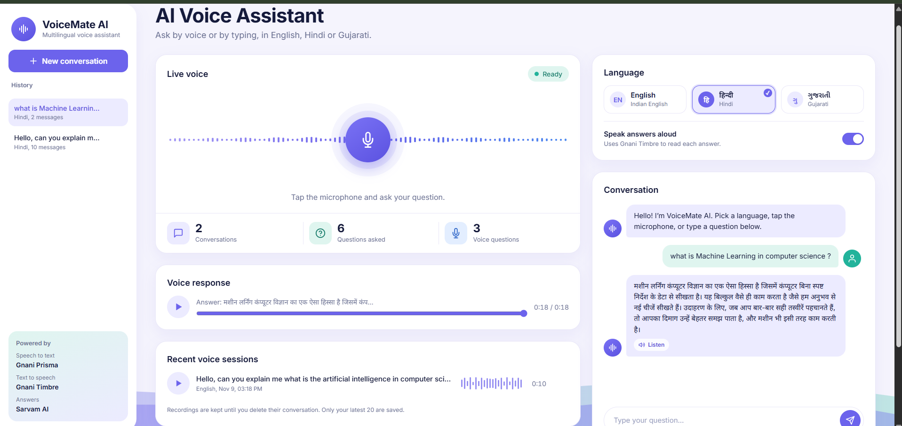

# VoiceMate AI 🎙️

**Your Multilingual AI Voice Assistant**

VoiceMate AI is an AI-powered voice assistant that allows users to speak or type questions in English, Hindi, and Gujarati. It understands the question and responds with text and voice in the selected language.

## 🚀 Live Demo

**Try VoiceMate AI here:**

[Open VoiceMate AI](https://voicemate-ai-sx1d.onrender.com)
[Drive Link](https://drive.google.com/file/d/1oRszxZZureGOcuk9uzYjZ8b7XzMAOcfn/view?usp=sharing)

*Note: The free Render server may sleep after inactivity. The first visit can take around a minute to load.*

## 📸 Project Screenshot

## ✨ Features

- Voice-based interaction.
- Text-based chat.
- Supports English, Hindi, and Gujarati.
- Speech-to-Text using Gnani Prisma.
- AI responses using Sarvam AI.
- Text-to-Speech using Gnani Timbre.
- Conversation history.
- Responsive user interface.

## 🛠️ Technologies Used

- Python
- Flask
- HTML, CSS, JavaScript
- Gnani Prisma (Speech-to-Text)
- Gnani Timbre (Text-to-Speech)
- Sarvam AI (AI Brain)
- SQLite
- Render (Deployment)

## 👩‍💻 Author

**Kavya Panchal**

Built as part of the **Great Indian AI Internship Challenge by Gnani AI**.

